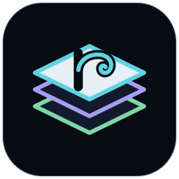

<p align="center">
  
</p>

<h1 align="center">rstack</h1>

<p align="center">
  The skills I carry into every repo: agent skills for Claude Code and Codex,<br>
  a git safety hook, and an optional set of global rules.
</p>

<p align="center">
  
  
  
  
</p>

<p align="center">
  <a href="#skills">Skills</a> ·
  <a href="#install">Install</a> ·
  <a href="#hooks">Hooks</a> ·
  <a href="#related">Related</a>
</p>

The skills are plain Markdown files. They work in any repo, and some are written for a
TypeScript, React and Convex stack. Most load on their own when a task matches their
description. Read [`START-HERE.md`](START-HERE.md) to choose one by hand.

## Quick start

```sh
git clone https://github.com/rk68/rstack.git && cd rstack
node install.mjs --dry-run   # print what would change
node install.mjs             # link the skills and register the hook
```

## Skills

Each table reads "use it when you ...".

### Write code

| Skill | Use it when you |
|---|---|
| `typescript-development` | write or change TypeScript or TSX |
| `convex-development` | write or change code under `convex/` |
| `convex-docs` | are not sure a Convex API exists in the installed version |
| `refactor` | change the structure of code without changing its behavior |
| `monorepo-refactor` | plan and run a refactor of a feature area or several packages, as a proposal and then small PRs |
| `prototype` | want throwaway code that answers a logic or UI design question |

### Design and plan

| Skill | Use it when you |
|---|---|
| `codebase-design` | design a module interface or decide where a seam goes |
| `improve-codebase-architecture` | want a report of refactor candidates for a codebase (type its name to start it) |
| `domain-modeling` | name domain terms, or write a `GLOSSARY.md` or an ADR |
| `grilling` | want the agent to question your plan before you build it |

### Test and debug

| Skill | Use it when you |
|---|---|
| `tdd` | fix a bug with a failing test first |
| `diagnosing-bugs` | have a bug or a slowdown and do not know the cause |
| `convex-verify` | need tests that prove a Convex function refuses the wrong user or organization |
| `flaky-tests` | want flaky tests found from CI history, confirmed locally and fixed at the root cause (daily or weekly) |
| `benchmark-checklist` | run a benchmark, or report a speedup or a regression you measured |

### Review and ship

| Skill | Use it when you |
|---|---|
| `typescript-review` | review a TypeScript diff |
| `convex-review` | review a diff that touches `convex/` |
| `blast-radius` | want to know what a change could break outside the diff |
| `merge-risk` | want a branch or PR scored and labelled by merge risk, with the review and split policy for that level |
| `review-loop` | review a branch with two Paseo reviewer agents that fix their verified findings, then push once |
| `commit-pr` | write a commit message, or open or update a pull request |

### Run agents in Herdr

| Skill | Use it when you |
|---|---|
| `herdr` | run and control agents and commands in the Herdr desktop app with `hc` |
| `herdr-delegate` | hand a task to another agent, or ask an advisor or a committee |
| `herdr-review` | review a branch with a Codex reviewer agent, fix its findings and push once |
| `herdr-worktrees` | create, inspect and clean up git worktrees for agents |
| `herdr-md` | show a Markdown file or a Mermaid diagram in Herdr's viewer, with highlights |

The `herdr` skills need the Herdr desktop app. `herdr-review` and `herdr-delegate` start agents
from the `hc` templates in [corral](https://github.com/rk68/corral).
`review-loop` needs the Paseo agent tools.

### Write prose

| Skill | Use it when you |
|---|---|
| `unslop` | edit a draft, README or PR body that reads as AI-written |
| `writing-for-agents` | write a skill, an `AGENTS.md` or a `CLAUDE.md` |

## Install

You need Node.js 18 or later.

```sh
node install.mjs --dry-run   # print what would change
node install.mjs             # link the skills and register the hook
node install.mjs --rules     # also add GLOBAL.md to your global agent instructions
node install.mjs --uninstall # remove everything the script added
```

The script does these things:

1. It links each folder in `skills/` into `~/.claude/skills/` (Claude Code) and
   `~/.agents/skills/` (Codex).
2. It registers the git guardrails hook in `~/.claude/settings.json` and `~/.codex/hooks.json`.
3. With `--rules` only, it adds a marked block to `~/.claude/CLAUDE.md` and `~/.codex/AGENTS.md`.
   The Claude block imports `GLOBAL.md`, so your edits apply at once. The Codex block is a copy,
   so run `node install.mjs --rules` again after you edit `GLOBAL.md`.

The script is safe to run more than once. It does not replace a file or folder that is not its
own link. It reports that path as a collision. The skills are links, so `git pull` in this
folder updates them.

`GLOBAL.md` holds opinionated rules for code, tests, stop points and writing style. Read it
before you install it with `--rules`. A repo's own `AGENTS.md` or `CLAUDE.md` wins where it is
more specific.

## Recommended skills from other sources

These are not copied here. Install them from their source so they stay up to date.

- React and Next.js performance rules from Vercel:
  `npx skills add vercel-labs/agent-skills --skill react-best-practices`.
  Use them for render and bundle performance only. The Next.js rules (`React.cache`,
  `next/dynamic`, `after()`, server components) do not apply to a Vite app, and the SWR rules
  do not apply to Convex.

## Hooks

`hooks/git-guardrails.mjs` runs before each shell command the agent runs. It blocks commands
that lose work or touch production:

- `git reset --hard`, `git clean -f`, `git checkout .`, `git restore .`
- `git branch -D`, `git push --force` (use `--force-with-lease`), `git stash drop` and `git stash clear`
- `convex deploy`, any `convex` command with `--prod`, and a `convex` command run with `CONVEX_DEPLOY_KEY`

When it blocks a command, the agent sees the reason and asks you to run the command yourself.
Run its tests with `node --test hooks/git-guardrails.test.mjs`.

## Related

- [corral](https://github.com/rk68/corral): the Herdr mods, layout and agent templates that the
  `herdr` skills drive.

## Licence

MIT. See [LICENSE](LICENSE).

Some skills are adapted from open-source projects by Lauren Tan (pstack), Matt Pocock and
Convex. [`THIRD_PARTY.md`](THIRD_PARTY.md) lists each source, its version and its licence, and the
licence texts are in `licenses/`. Those parts keep their own licences.
